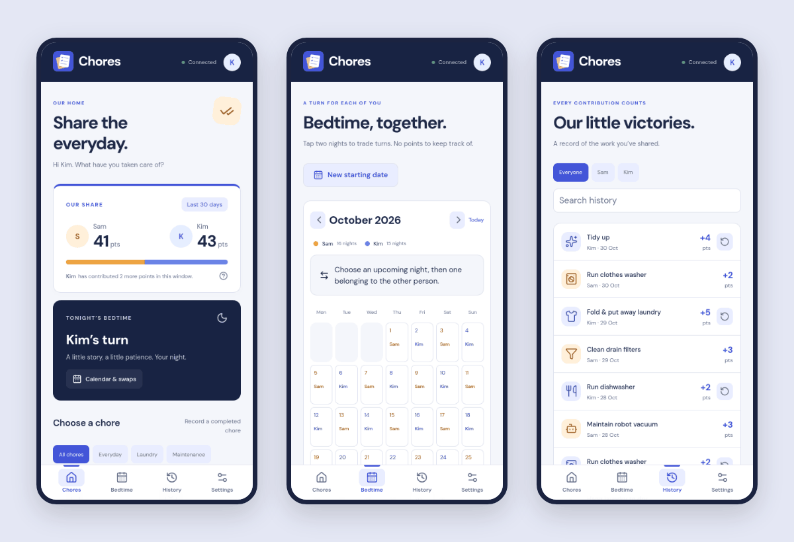
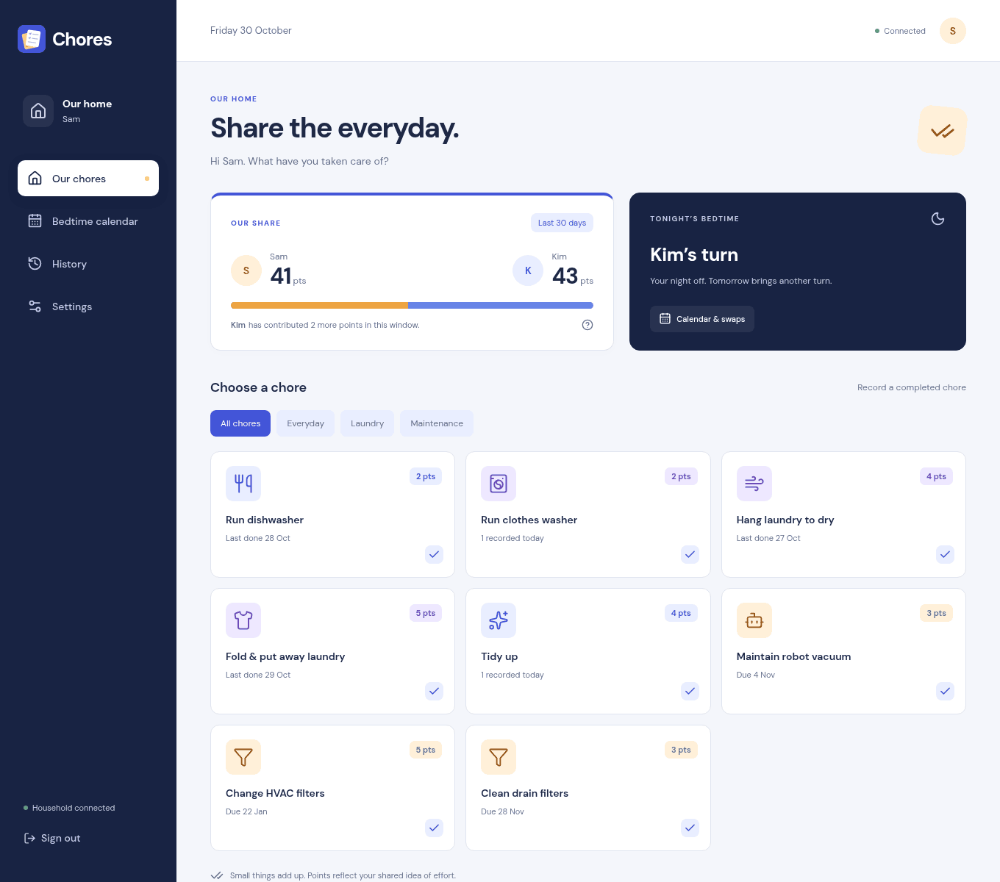

<p align="center">
  
</p>

<h1 align="center">Chores</h1>

A small app for two adults sharing a home. You each log the chores you've done, see how the points balance out over the last month, and take turns with the kids' bedtime. It's self-hosted and built for exactly two accounts.

<p align="center">
  
</p>



_Screenshots use a throwaway household with mock history._

## What it does

Tap a chore when you've done it and it's credited to you, optionally with a date and a note. Chores have points that the two of you agree on, a category and an icon, and maintenance jobs (changing filters, cleaning the robot vacuum) can have an interval so the app shows when they're next due. Changing a chore's points only affects future entries; past ones keep the value they were recorded with.

The home screen shows both totals over a rolling window, 30 days by default, or a different period or all time if you prefer. History lists every entry and lets you undo your own, and the undo is kept in the history too.

Bedtime alternates night by night. To trade, tap one of your upcoming nights and then one of the other person's, and the two nights swap, so you both keep the same number of turns. Swaps can be undone, and you can restart the alternation from any date without changing the nights before it. Bedtime isn't worth points.

Each person has their own login and recovery code, and changes show up on the other phone within a few seconds. Recording needs a connection; if a request gets lost, retrying it won't count the chore twice. Over HTTPS it can be installed to the home screen as a PWA.

## Running it locally

You need Nix with flakes; the dev shell has Node, Rust and Chromium.

```sh
nix develop
npm ci
npm run dev
# in a second `nix develop` shell
cargo run --manifest-path backend/Cargo.toml
```

Open http://localhost:3101 (Vite proxies `/api` to port 3002). The first launch asks for the household name, both people's names, emails and passwords, and who has bedtime on a given night. There's no setup token. Data goes to `data/`, which Git ignores.

## Configuration

- `CHORES_ORIGIN`: the exact URL you open the app at, e.g. `https://chores.example.com`.
- `CHORES_DATA_DIR`: where the SQLite database lives (`/data` in the container).
- `CHORES_SQLITE_JOURNAL_MODE=DELETE` if that directory is on NFS.
- `CHORES_OIDC_ISSUER`, `CHORES_OIDC_CLIENT_ID`, `CHORES_OIDC_CLIENT_SECRET` and `CHORES_OIDC_USER_MAP` for optional passkey sign-in through an OpenID Connect provider such as Pocket ID.

Chore names, points, categories and the balance period are set in the app.

## Deploying

CI publishes `ghcr.io/fruitiex/chores:main`. The container runs the API and serves the frontend on port 8080 as a non-root user. Mount persistent storage at `/data`, run a single replica, and put it behind your own HTTPS reverse proxy with `CHORES_ORIGIN` set to match. It's meant for a private network.

```sh
nix build .#container
docker load -i result
```

Example Kubernetes manifests are in [deploy/kubernetes](deploy/kubernetes). [docs/DEPLOYMENT.md](docs/DEPLOYMENT.md) covers first launch, OIDC setup, backups, restores and upgrades.

## Development

The frontend is React, TypeScript and Vite; the backend is Rust with SQLite. Checks:

```sh
nix develop --command cargo fmt --manifest-path backend/Cargo.toml -- --check
nix develop --command cargo clippy --manifest-path backend/Cargo.toml -- -D warnings
nix develop --command cargo test --manifest-path backend/Cargo.toml
nix develop --command npm run typecheck
nix develop --command npm run format:check
nix develop --command npm run build
nix develop --command npm run test:ui
```

`test:ui` starts the production build against a temporary database, signs in both accounts in headless Chromium, runs through chores, bedtime swaps and passkey sign-in, and saves screenshots to `test-results/`. Set `CHORES_TEST_BINARY` to test a different backend build. [docs/PLAN.md](docs/PLAN.md) records the original requirements.

## Credits

DM Sans is bundled from Google Fonts under the SIL Open Font License (`public/fonts/`). Icons are [Lucide](https://lucide.dev) (ISC license). The app icon is original artwork in `public/icon.svg`; `scripts/make-icons.mjs` renders the install icons from it.

## License

MIT, see [LICENSE](LICENSE).
